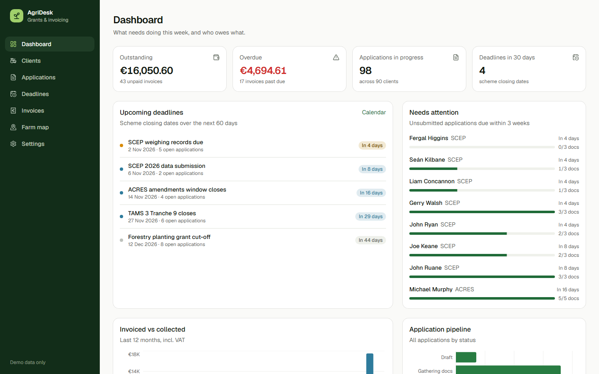
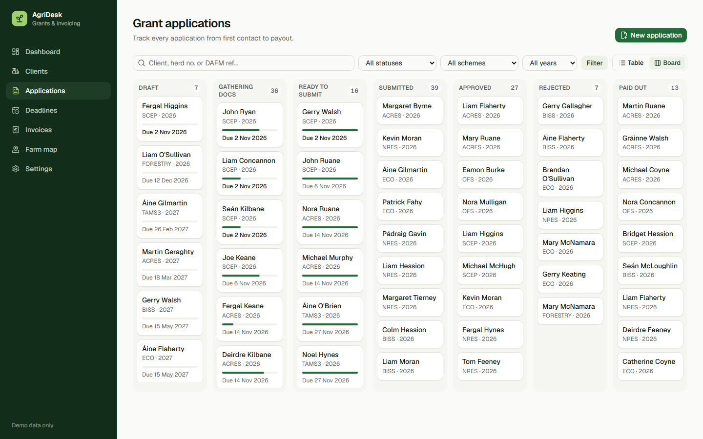
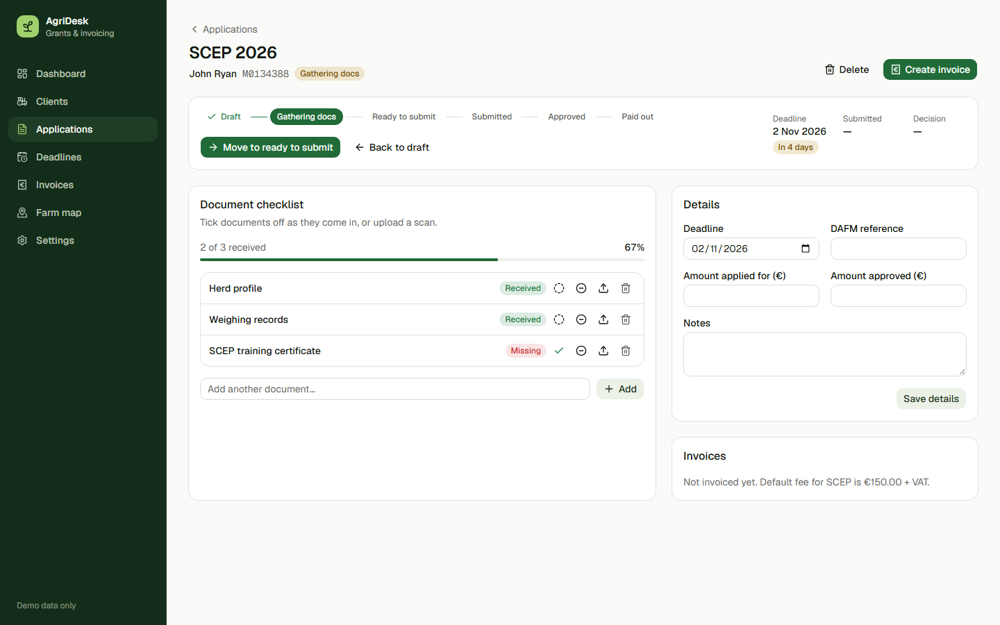
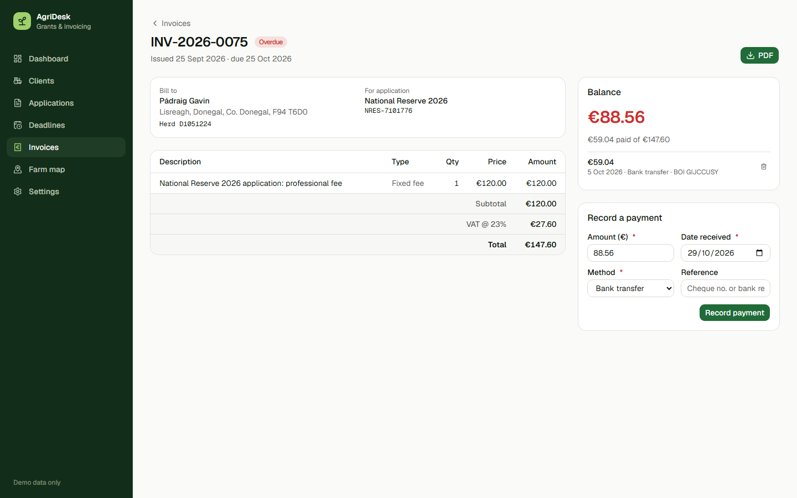
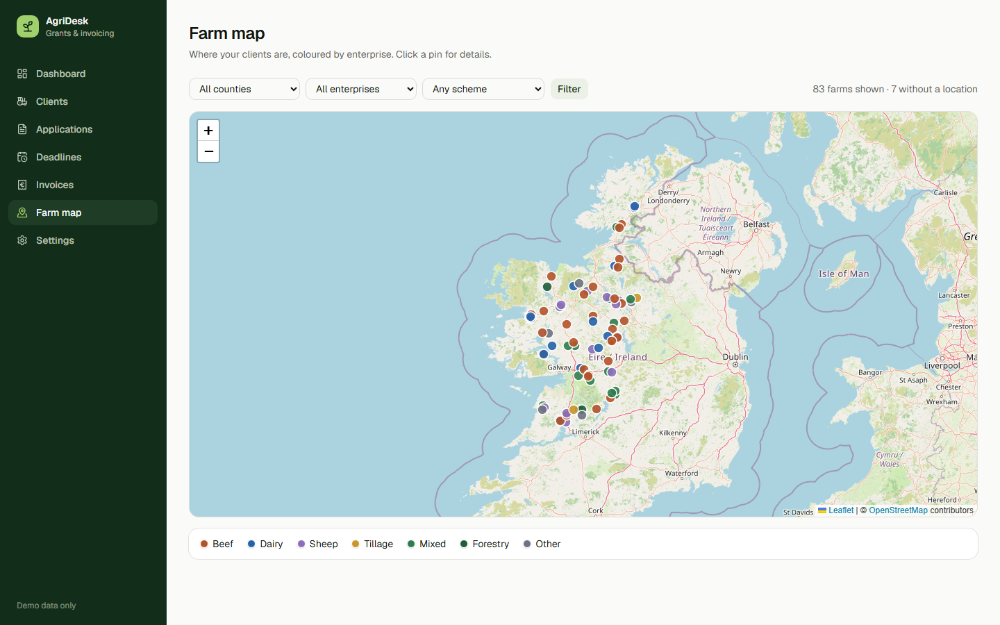
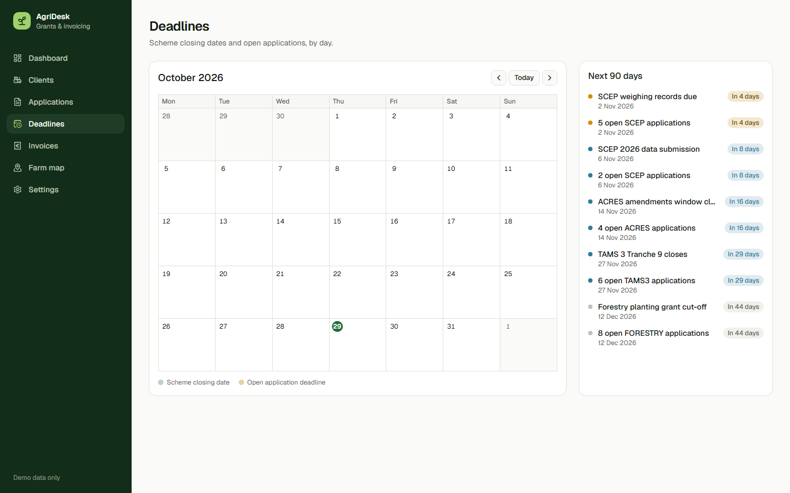
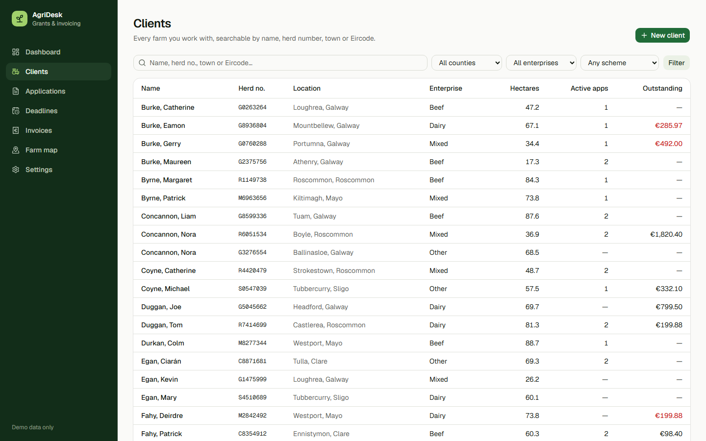
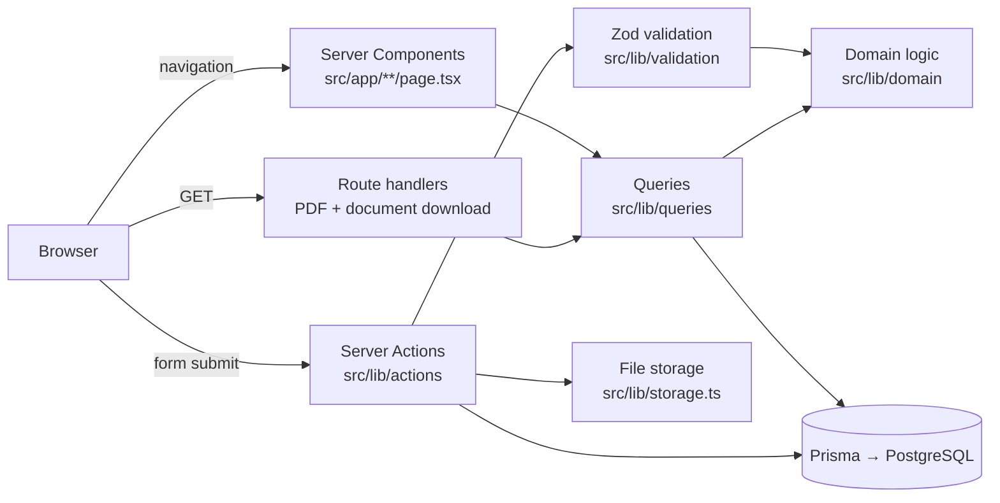
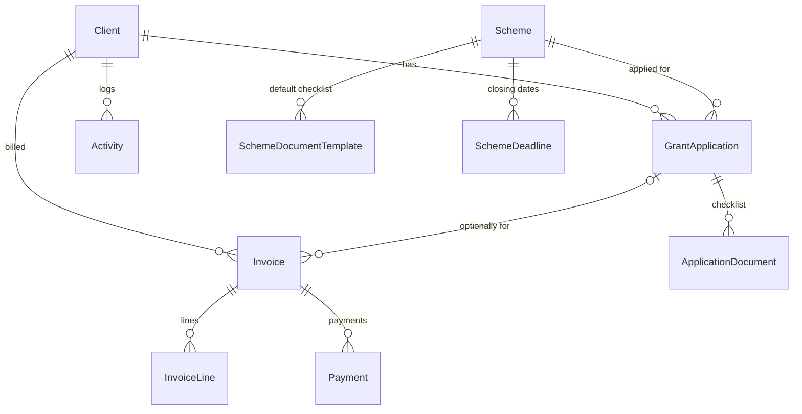

# AgriDesk

**Client, grant-application and invoice management for an agricultural consultant.**

My dad is an agricultural consultant in the west of Ireland with over 500 farm clients. Most of his work is preparing and tracking grant applications (ACRES, TAMS, BISS, Eco-Scheme and others) and invoicing farmers for that work, and until now it all lived on paper. AgriDesk replaces the notebooks with a single place to see every farm, what's due this week, which documents are still missing, and who owes what.



> All data in this repository and in the screenshots is fictional, generated by `prisma/seed.ts`.

## Features

- **Client database**: one record per herd, with herd number and Eircode validation, enterprise type, hectares, DAFM/Agfood references, and a farm location picked by clicking a map. Server-side search across name, herd number, town, Eircode and phone, with county, enterprise and scheme filters.
- **Grant applications**: a status workflow (Draft → Gathering docs → Ready → Submitted → Approved/Rejected → Paid out) with only valid transitions allowed. Each scheme's document checklist is copied onto new applications, documents are ticked off or uploaded, and progress shows at a glance. Table and kanban board views.
- **Deadlines**: scheme closing dates and open-application deadlines on a month calendar and a 90-day agenda, colour-coded by urgency. The dashboard highlights unsubmitted applications due within three weeks.
- **Invoicing**: fixed-fee and hourly line items, 23% VAT (configurable per invoice), and fees pre-filled from the scheme. Drafts get a sequential `INV-YYYY-NNNN` number only when issued, so the numbering never has gaps. Supports part payments and voids. Paid, part-paid and overdue are derived from payments and the due date, never stored.
- **PDF invoices**: generated on the server with React-PDF, including business details, bank details and the balance due.
- **Farm map**: every client on an OpenStreetMap/Leaflet map, coloured by enterprise and filterable by county, enterprise or scheme.
- **Activity log**: calls, visits and notes per client. Submissions and payments are logged automatically.
- **Responsive**: the whole app works on a phone, for use in the yard.

| Applications board | Application detail |
| --- | --- |
|  |  |
| **Invoice** | **Farm map** |
|  |  |
| **Deadlines** | **Clients** |
|  |  |

## Tech stack

| Area | Choice |
| --- | --- |
| Framework | Next.js 16 (App Router, Server Components, Server Actions, Cache Components / Partial Prerendering) |
| Language | TypeScript (strict) |
| Database | PostgreSQL 16 via Docker, Prisma 7 ORM with the `pg` driver adapter |
| Validation | Zod schemas shared by forms and server actions |
| UI | Tailwind CSS 4, shadcn/ui (Radix), Lucide icons, Recharts |
| Maps | Leaflet + react-leaflet with OpenStreetMap tiles |
| PDF | @react-pdf/renderer |
| Testing | Vitest (domain logic), Playwright (end-to-end) |
| CI | GitHub Actions: lint, type-check, unit tests, build, and e2e against a Postgres service container |

## Architecture



- **`src/lib/domain/`** holds pure, framework-free business rules: money and VAT in integer cents, invoice totals and derived status, the application state machine, checklist progress, herd number and Eircode validation, and deadline urgency. Vitest covers these exhaustively.
- **`src/lib/queries/`** contains server-only data loaders used by Server Components.
- **`src/lib/actions/`** contains Server Actions. Each one validates `FormData` with Zod, applies domain rules, writes through Prisma (in a transaction where several rows change), and revalidates affected routes.
- **Pages** render a static shell immediately and stream data inside `<Suspense>` (Partial Prerendering). "Today" is read once per request in Irish time (`src/lib/today.ts`), so overdue checks are consistent.
- **Money** is always stored as integer cents and dates-without-times as Postgres `date`, which avoids floating-point and time-zone bugs.

### Data model



The full schema is in [`prisma/schema.prisma`](prisma/schema.prisma).

## Running locally

Requirements: Node.js 20.9+, Docker Desktop.

```bash
git clone <this repo> agridesk && cd agridesk
cp .env.example .env
npm install
npm run db:up        # start Postgres in Docker
npm run db:migrate   # create the schema
npm run db:seed      # ~90 fictional farms with applications and invoices
npm run dev          # http://localhost:3000
```

Seed dates are relative to the day you run it, so the dashboard always has upcoming deadlines and recent payments. Re-run `npm run db:seed` at any time to reset the demo data.

### Scripts

| Command | What it does |
| --- | --- |
| `npm run dev` / `build` / `start` | Next.js dev server, production build, production server |
| `npm test` | Vitest unit tests for the domain layer |
| `npm run test:e2e` | Playwright: creates a client, runs a grant application through to a paid invoice, checks the PDF |
| `npm run lint` / `typecheck` | ESLint and `tsc --noEmit` |
| `npm run db:reset` | Drop, re-migrate and re-seed the database |
| `npx tsx scripts/screenshots.ts` | Regenerate the README screenshots from a running app |

## Design decisions

- **No authentication (yet).** The app is built for one consultant on a local machine or private network. Adding Auth.js with a single account would be the first step before any hosted deployment; every Server Action is a single entry point where that check would go.
- **Invoice numbers on issue, not on creation.** Irish VAT rules expect a continuous invoice sequence, so drafts stay unnumbered and can be deleted freely. Issued invoices can only be voided.
- **Derived payment status.** "Overdue" depends on today's date and "Paid" on the sum of payments. Storing either would let them drift, so both are computed from the source data.
- **Coordinates by map click.** Eircode geocoding requires a paid API, so the farm location is set by clicking the map on the client form.
- **Local file storage** for uploaded documents (`uploads/`, gitignored) behind a four-function module (`src/lib/storage.ts`) that can be swapped for S3 or Azure Blob.

## Roadmap

- Login (Auth.js) and hosted deployment
- CSV import and export for existing client lists
- Email invoices and payment reminders directly from the app
- Recurring yearly applications (BISS/Eco-Scheme) created in bulk for all eligible clients
